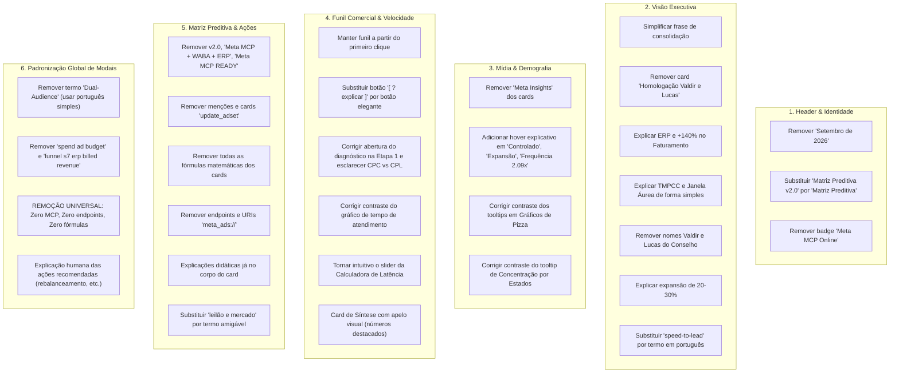

# Plano de Implementação Modular: Refinamento & Simplificação do Dashboard StartMedia Intelligence (Kota Saúde e Beleza)

> **Documento:** Plano de Engenharia e Refinamento de Frontend (React 19 / TypeScript / Tailwind CSS)  
> **Arquivo Local do Projeto:** `PLANO_REFINAMENTO_MODULAR.md`  
> **Status:** Aprovado para Execução Modular  
> **Diretório Alvo Isolado:** `C:\Users\Andre\Documents\André\Antigravity\startmedia-kota\kota_dashboard_marketing`  
> **Pilares:** Clareza Executiva, Remoção Total de Siglas/Fórmulas MCP Herméticas, Contraste Visual Perfeito e Didática de Negócios.

---

## 1. Diagnóstico e Matriz de Modificações Solicitadas

O usuário solicitou uma revisão profunda do Dashboard StartMedia Intelligence para eliminar jargões desnecessários, remover 100% das menções técnicas de MCP e fórmulas matemáticas, enriquecer a didática dos cards e modais para a diretoria da Kota Saúde e Beleza, e corrigir contrastes visuais de tooltips.

### 1.1 Resumo dos 6 Eixos de Transformação



---

## 2. Especificação Técnica Modular Detalhada

### MÓDULO 1: Header, Identidade e Estrutura Global
**Arquivos Impactados:**
- `src/components/layout/Navbar.tsx`
- `src/components/layout/DashboardLayout.tsx`
- `src/App.tsx`

**Diretrizes de Implementação:**
1. **Seletor de Período no Navbar:**
   - Alterar o botão `Setembro (30d)` para `Últimos 30 Dias` ou `Consolidado (30d)`, desvinculando de rótulo fixo "Setembro de 2026".
2. **Abas de Navegação:**
   - Na 4ª aba: alterar o texto de `Matriz Preditiva v2.0` para estritamente `Matriz Preditiva`.
3. **Remoção de Badge MCP:**
   - Remover integralmente o badge com ping pulsante `"Meta MCP Online"` e seu ícone do lado direito do cabeçalho.
   - Manter o layout equilibrado com o seletor de período e a identificação StartMedia / Kota Saúde e Beleza.

---

### MÓDULO 2: Visão Geral Executiva (`ExecutiveOverviewModule.tsx`)
**Arquivos Impactados:**
- `src/components/modules/overview/ExecutiveOverviewModule.tsx`

**Diretrizes de Implementação:**
1. **Hero Header:**
   - Remover a menção a "Setembro 2026" do subtítulo.
   - Substituir a frase complexa:
     * *Antes:* `"Consolidação de ponta a ponta: do leilão e compra de mídia Meta Ads ao faturamento auditado no ERP Kota Dental, com 20 funcionalidades de inteligência preditiva e governança de resposta rápida."*
     * *Depois (Simples & Direta):* `"Visão integrada de investimento em anúncios e vendas geradas: acompanhamento em tempo real do tráfego até o dinheiro faturado na Kota."`
   - **Remover o Card Lateral:** Excluir completamente o card `"Homologação Diretoria - Waldir Ward & Lucas - 3 Módulos Sincronizados em Tempo Real"`.
2. **Os 4 Golden KPIs:**
   - **Card 1 (Investimento Total):** Manter valor R$ 7.546, variação -1,8% vs mês anterior.
   - **Card 2 (Faturado):**
     * Título do card: `"Faturamento Confirmado"` com subtítulo explicativo: `"(Vendas registradas no sistema de gestão/caixa)"`.
     * Explicar o que é ERP: badge/tooltip ou texto auxiliar clarificando que ERP é o sistema interno de emissão de pedidos e notas fiscais da empresa.
     * Explicar `+140% vs Histórico`: texto explicativo informando que o faturamento de R$ 36.000 representa mais que o dobro da média mensal anterior de vendas originadas por anúncios digitais.
   - **Card 3 (ROAS Comercial):** Manter 4,77x (R$ 4,77 de retorno para cada R$ 1,00 investido).
   - **Card 4 (Tempo de Resposta Inicial):**
     * Renomear de `"TMPCC Resposta"` para `"Tempo Médio de Primeiro Contato"` ou `"Tempo de Resposta ao Cliente"`.
     * Explicar o que é o indicador: tempo médio que a equipe de vendas leva para mandar a primeira mensagem no WhatsApp assim que o cliente clica no anúncio (4.8 minutos).
     * Explicar `"Janela Áurea"`: tag ou texto simples esclarecendo: *"Janela Áurea: primeiros 5 minutos após o lead solicitar contato, momento de máxima chance de fechar venda (78,4% dos contatos atendidos nesse prazo)"*.
3. **Seção "Diretrizes Estratégicas para o Conselho":**
   - No título da seção: alterar para `"Diretrizes Estratégicas para a Diretoria"` (remover `"Waldir Ward & Lucas"`).
   - Remover o badge `"Status: Homologado 100%"`.
   - **Card 1 (Escalabilidade Validada):**
     * Reescrever explicando claramente por que há espaço para expansão de 20% a 30%: *"Com retorno de R$ 4,77 por real investido e frequência saudável de 2.09x (sem cansaço de público), a empresa pode aumentar o investimento em até 30% sem encarecer o custo de novos clientes e sem sobrecarregar a equipe comercial."*
   - **Card 3 (Agilidade no Primeiro Atendimento):**
     * Renomear de `"Automação Speed-to-Lead"` para `"Agilidade no Primeiro Atendimento"`.
     * Retirar o trecho que sugeria `"integrando o plantão de fim de semana"`. Focar na sustentação da taxa de 78,4% em menos de 5 minutos durante o horário comercial.

---

### MÓDULO 3: Mídia & Matriz Demográfica (`BigNumbersGrid.tsx`, `DemographicsGrid.tsx`)
**Arquivos Impactados:**
- `src/components/common/MetricCard.tsx`
- `src/components/modules/etapa1/BigNumbersGrid.tsx`
- `src/components/modules/etapa1/DemographicsGrid.tsx`
- `src/data/etapa1Data.ts`

**Diretrizes de Implementação:**
1. **Limpeza nos Cards (`MetricCard.tsx` e `BigNumbersGrid.tsx`):**
   - Remover definitivamente o texto `• Meta Insights` de dentro de todos os cards.
2. **Hover Explicativo nos Indicativos de Status:**
   - Nos indicativos como `"Controlado"`, `"Expansão"`, `"Frequência 2,09x"`, `"Dentro da Meta"`:
   - Implementar um tooltip interativo/hover estruturado que explica:
     * **O que significa o estado atual:** (Ex.: Frequência 2,09x = cada pessoa viu o anúncio cerca de 2 vezes no mês).
     * **Quais são as outras opções possíveis e cenários:**
       - *Frequência < 1.5x (Baixa):* O anúncio quase não é lembrado.
       - *Frequência 1.5x a 3.0x (Ideal/Controlado - Cenário Atual):* Ponto ótimo de memorização sem irritar o público.
       - *Frequência > 3.5x (Saturado/Crítico):* O público cansa de ver o mesmo anúncio, o custo por lead sobe e o anúncio precisa ser trocado imediatamente.
     * Idem para `"Controlado"` (orçamento sendo consumido no ritmo correto vs Subgasto ou Desperdício) e `"Expansão"` (ganho de novas contas vs Encolhimento de audiência).
3. **Correção de Contraste nos Gráficos de Pizza / Donut (`DemographicsGrid.tsx`):**
   - Nos gráficos de Dispositivos, Plataformas e Posicionamentos:
   - Configurar o `<Tooltip />` do Recharts com estilização customizada:
     * Fundo: `#1c1c1c` ou `#222222`
     * Borda: `#3f3f46`
     * `itemStyle={{ color: '#ffffff', fontWeight: 600 }}`
     * `labelStyle={{ color: '#a1a1aa', fontWeight: 500 }}`
     * Garantir contraste 100% legível com texto branco e rótulos nítidos.
4. **Correção de Contraste no Card Concentração por Estados:**
   - No `<BarChart />` de estados brasileiros:
   - Aplicar a mesma correção no `<Tooltip />` do Recharts com `itemStyle={{ color: '#ffffff' }}` e `labelStyle={{ color: '#e4e4e7' }}`, eliminando o texto preto em fundo escuro.

---

### MÓDULO 4: Funil Comercial & Velocidade (`CommercialFunnelPipeline.tsx`, `SpeedToLeadMonitor.tsx`, `Etapa2Module.tsx`)
**Arquivos Impactados:**
- `src/components/modules/etapa2/CommercialFunnelPipeline.tsx`
- `src/components/modules/etapa2/SpeedToLeadMonitor.tsx`
- `src/components/modules/etapa2/Etapa2Module.tsx`
- `src/data/etapa2Data.ts`

**Diretrizes de Implementação:**
1. **Esteira Comercial:**
   - Manter a esteira começando diretamente em *"1. Cliques em Anúncios (4.930)"* e avançando até *"7. Faturamento Confirmado (R$ 36.000)"*.
   - No modo "Gráfico Proporcional": substituir o link/texto feio `[ ? Explicar ]` por um botão estético de design system:
     * Botão com ícone `HelpCircle`, fundo `bg-zinc-800 hover:bg-zinc-700`, borda sutil, cantos arredondados, texto `Entender Etapa` e micro-animação no hover.
2. **Card "Detalhe da Etapa 01: Cliques em Anúncios":**
   - Esclarecer o motivo dos números: o valor de **R$ 1,53** é o Custo por Clique (CPC), enquanto o Custo por Cadastro (CPL) é R$ 9,66 geral e R$ 6,42 na campanha direta. Deixar essa distinção explícita no texto descritivo para não haver confusão de que o lead custou caro.
   - Garantir que o botão `"Ver Diagnóstico Completo"` abra o modal explicativo perfeitamente integrado e com as 4 seções didáticas preenchidas.
3. **Distribuição do Tempo de Atendimento:**
   - No gráfico de barras de intervalos de tempo: corrigir o tooltip do Recharts para fundo carvão com texto branco brilhante (`#FFFFFF`), garantindo legibilidade do volume de contatos e porcentagens.
4. **Calculadora de Impacto de Latência:**
   - Adicionar uma instrução visual destacada acima do slider: *"👉 Arraste o botão abaixo para escolher o tempo médio de resposta da sua equipe e veja a simulação do impacto no faturamento em tempo real"*.
5. **Card de Síntese Executiva para a Diretoria (`Etapa2Module.tsx`):**
   - Reduzir o tamanho dos blocos de texto corrido.
   - Apresentar as informações com alto apelo visual (Grid de mini-cards / badges destacados):
     * **Investimento em Anúncios:** `R$ 7.546`
     * **Vendas Fechadas:** `12 contratos`
     * **Ticket Médio:** `R$ 3.000`
     * **Faturamento Real:** `R$ 36.000`
     * **Retorno (ROAS):** `4,77x`
     * **Tempo de Atendimento:** `4.8 min (78,4% na Janela Áurea)`
     * **Leads Descartados (Filtro Anti-Curioso):** `112 contatos poupados`

---

### MÓDULO 5: Matriz Preditiva & Ações em 1 Clique (`PredictiveMatrix.tsx`, `QuickActionsPanel.tsx`, `Etapa3Module.tsx`)
**Arquivos Impactados:**
- `src/components/modules/etapa3/Etapa3Module.tsx`
- `src/components/modules/etapa3/QuickActionsPanel.tsx`
- `src/components/modules/etapa3/PredictiveMatrix.tsx`
- `src/data/etapa3Data.ts`

**Diretrizes de Implementação:**
1. **Cabeçalho da Seção (`Etapa3Module.tsx`):**
   - Alterar título de `"Inteligência Algorítmica v2.0"` para `"Inteligência Preditiva"`.
   - Remover o badge `"Meta MCP + WABA + ERP"`.
2. **Painel de Ações Rápidas (`QuickActionsPanel.tsx`):**
   - Remover o badge `"Meta MCP Ready"`.
   - Remover a menção de sidecar MCP.
   - Remover o card/termo `"update_adset"` e qualquer código técnico de dentro dos cards.
   - Explicar as 3 ações recomendadas em linguagem 100% de negócios:
     * **Ação 1: Rebalanceamento Inteligente de Verba:** Explicar que a automação transfere verba de públicos com pouca venda (como Lookalike frio) e concentra 61% do orçamento em Laboratórios de Prótese e 34,8% em Clínicas, projetando aumento de +38,5% nas vendas sem gastar um centavo a mais.
     * **Ação 2: Trava de Segurança no Orçamento Diário:** Explicar que o sistema limita o investimento diário ao ponto ideal de R$ 420/dia, impedindo que o aumento desordenado de verba faça o custo por cliente disparar.
     * **Ação 3: Substituição de Anúncio Saturado:** Explicar que o sistema pausa anúncios que o público já viu repetidas vezes (como o AzuleneCap) e ativa novas variações do vídeo campeão da Dra. Cíntia para manter o custo baixo.
3. **Cards da Matriz Preditiva (`PredictiveMatrix.tsx` e `etapa3Data.ts`):**
   - **Remoção de Fórmulas:** Remover o bloco de fórmulas matemáticas (`ƒ: ...`) de TODOS os cards. Substituir por uma explicação didática e rápida de como a métrica é avaliada.
   - **Remoção de Endpoints:** Excluir completamente `meta_ads://detect_anomalies?metric=frequency_saturation` e qualquer outro endpoint/URI de todos os 20 cards.
   - **Renomeação dos Pilares:** Substituir o termo `"Leilão & Mercado"` por `"Desempenho dos Anúncios & Audiência"`.
   - **Didática no Próprio Card:** Em cada card (ex.: RSDF, CDCL, MEO-POE), incluir um resumo autoexplicativo direto na face do card, para que o usuário compreenda o objetivo do indicador imediatamente sem precisar abrir o modal.

---

### MÓDULO 6: Padronização Universal de Modais (`MetricModal.tsx`, `metricExplanations.ts`)
**Arquivos Impactados:**
- `src/components/common/MetricModal.tsx`
- `src/types/modalTypes.ts`
- `src/data/metricExplanations.ts`

**Diretrizes de Implementação:**
1. **Limpeza Estrutural do `<MetricModal />`:**
   - Remover o cabeçalho `"Guia Explicativo Dual-Audience"`. Substituir por `"Guia Explicativo do Indicador • Kota Saúde e Beleza"`.
   - Remover termos em inglês soltos como `"spend ad budget"` no card de investimento e `"funnel s7 erp billed revenue"` no modal de faturamento.
   - **SEÇÃO 2 (VISÃO TÉCNICA):**
     * Renomear de `"2. VISÃO TÉCNICA META ADS & MCP API"` para `"2. VISÃO OPERACIONAL META ADS"`.
     * **REMOVER:** Endpoint MCP, Fórmula Matemática e qualquer menção a MCP.
     * **MANTER:** Métrica Oficial no Meta Ads, Evento de Conversão e Parâmetros Práticos de Otimização (explicados de forma limpa).
   - **SEÇÃO 3 (DIAGNÓSTICO KOTA):**
     * Remover menções a "Setembro de 2026", mantendo "Período Consolidado vs Histórico".
   - **SEÇÃO 4 (AÇÃO RECOMENDADA EM 1 CLIQUE):**
     * Remover o terminal com comando MCP (`$ update_adset...`).
     * Remover o badge `"Meta MCP Executor"`.
     * Apresentar a explicação clara de como a ação funciona na prática e o botão de execução com feedback de sucesso em português claro: `[ Aplicar Otimização Recomendada ]`.
2. **Atualização do Dicionário `src/data/metricExplanations.ts`:**
   - Atualizar todos os verbetes cadastrados para expurgar 100% de termos MCP, endpoints e fórmulas herméticas, substituindo por explicações claras e de fácil absorção para diretores e gestores.

---

## 3. Protocolo de Delegação Multiagente (5 Subagentes)

Para garantir execução paralela limpa, sem regressões e com total isolamento de escopo:

```text
                                  ┌─────────────────────────────┐
                                  │   TECH LEAD & ORQUESTRADOR  │
                                  └──────────────┬──────────────┘
                                                 │
          ┌──────────────────────┬───────────────┴──────────────┬──────────────────────┐
          ▼                      ▼                              ▼                      ▼
    SUBAGENTE 1            SUBAGENTE 2                    SUBAGENTE 3            SUBAGENTE 4
 [Design & Modal Base] [Visão Geral & Mídia]          [Funil & Atendimento]   [Preditivo & Ações]
  • Navbar.tsx          • ExecutiveOverviewModule.tsx  • CommercialFunnel.tsx  • PredictiveMatrix.tsx
  • MetricModal.tsx     • BigNumbersGrid.tsx           • SpeedToLeadMonitor.tsx• QuickActionsPanel.tsx
  • MetricCard.tsx      • DemographicsGrid.tsx         • Etapa2Module.tsx      • Etapa3Module.tsx
  • modalTypes.ts       • Tooltips Recharts            • Calculadora Slider    • etapa3Data.ts
          │                      │                              │                      │
          └──────────────────────┴───────────────┬──────────────┴──────────────────────┘
                                                 │
                                                 ▼
                                           SUBAGENTE 5
                                   [Quality Assurance & Auditor]
                                    • metricExplanations.ts (Audit)
                                    • npm run build (0 erros TS)
                                    • Teste de clique de todos os cards
```

### Agente 1 (Design, Shell & Modal Architect)
- **Escopo:** Módulo 1 (Navbar sem Setembro e sem MCP) e Módulo 6 (Estrutura do `MetricModal.tsx`, simplificação dos títulos, remoção de Dual-Audience, remoção de código MCP do modal e refatoração do `MetricCard.tsx` com hover para status).

### Agente 2 (Executive Overview & Media Demographics Specialist)
- **Escopo:** Módulo 2 (`ExecutiveOverviewModule.tsx`: remoção de Valdir/Lucas, explicação de ERP/+140%, TMPCC, Janela Áurea, expansão 20-30%) e Módulo 3 (`BigNumbersGrid.tsx` sem Meta Insights, hovers explicativos das opções de frequência/controle e `DemographicsGrid.tsx` com tooltips de alto contraste branco sobre cinza).

### Agente 3 (Commercial Funnel & Speed Specialist)
- **Escopo:** Módulo 4 (`CommercialFunnelPipeline.tsx`: botão elegante, distinção CPC vs CPL, `SpeedToLeadMonitor.tsx`: contraste nos gráficos, instrução da calculadora, e `Etapa2Module.tsx`: síntese com cards visuais).

### Agente 4 (Predictive Intelligence & 1-Click Specialist)
- **Escopo:** Módulo 5 (`PredictiveMatrix.tsx`: remoção de fórmulas e endpoints, didática no card, renomeação de Leilão & Mercado, e `QuickActionsPanel.tsx`: remoção de `update_adset`, explicação humana das ações em 1 clique).

### Agente 5 (Quality Assurance & Production Build Auditor)
- **Escopo:** Revisão final de `src/data/metricExplanations.ts`, garantia de que nenhuma referência a MCP/fórmulas permaneceu nos modais, validação de navegação nas 4 abas, e execução de `npm run build` certificando zero erros TypeScript.

---

## 4. Garantia de Isolamento de Diretórios

Todas as operações de criação, modificação de arquivos, inspeção e build serão executadas estritamente dentro da pasta do projeto:
`C:\Users\Andre\Documents\André\Antigravity\startmedia-kota\kota_dashboard_marketing`

Nenhum arquivo externo ou fora deste escopo será modificado.

---

## 5. Critérios de Aceite para Homologação

1. [ ] A aba superior não menciona "Setembro de 2026" (usa rótulo consolidado/últimos 30 dias) e exibe "Matriz Preditiva" (sem v2.0).
2. [ ] Nenhum badge "Meta MCP Online" ou "Meta MCP Ready" visível no cabeçalho ou cards.
3. [ ] O card "Homologação Diretoria - Valdir e Lucas" foi removido da Visão Executiva.
4. [ ] O card de Faturamento explica o que é ERP e o significado de +140% vs histórico.
5. [ ] O card de tempo de resposta explica o que é o TMPCC em linguagem simples e o que é a Janela Áurea.
6. [ ] 100% dos modais explicativos estão livres de menções a MCP, endpoints (ex: `meta_ads://...`) e fórmulas matemáticas.
7. [ ] O termo "Dual-Audience" foi substituído por linguagem simples em português em todos os modais.
8. [ ] Os indicativos como "Controlado", "Expansão" e "Frequência 2.09x" possuem efeito hover explicando as demais faixas possíveis e seus impactos.
9. [ ] Os gráficos de pizza e de estados possuem tooltips com alto contraste (fundo cinza escuro, texto branco 100% legível).
10. [ ] O botão `[ ? Explicar ]` no afunilamento foi substituído por um botão estético de design system.
11. [ ] O card de síntese executiva da Etapa 2 apresenta métricas destacadas de forma visual em vez de parágrafos densos.
12. [ ] Os cards da Matriz Preditiva não possuem fórmulas matemáticas nem referências a `update_adset` ou `detect_anomalies`.
13. [ ] `npm run build` compila com zero erros TypeScript.
